# 📱 Awesome Real Device Cloud ☁️

  
  
  
  
  
  

**A curated directory of top Real Device Cloud platforms, mobile test execution grids, enterprise device farms, and open-source self-hosted solutions for remote Android & iOS testing, debugging, and continuous integration.**

---

Real Device Clouds allow mobile engineering, QA, and DevOps teams to execute automated test suites (such as **Appium**, **Espresso**, **XCUITest**, and **Playwright**) and perform real-time interactive debugging on physical smartphones, tablets, and smart TVs without maintaining complex and expensive in-house hardware setups.

---

## 📋 Table of Contents

- [📈 Sector Overview & Market Dynamics](#-sector-overview--market-dynamics)
- [🟦 SaaS / Hosted Real Device Clouds](#-saas--hosted-real-device-clouds)
- [🟩 Open-Source Device Farms & Platforms](#-open-source-device-farms--platforms)
- [🔍 Detailed SaaS Platform Summaries](#-detailed-saas-platform-summaries)
- [🛠️ Detailed Open-Source Tool Overviews](#-detailed-open-source-tool-overviews)
- [📊 Comparison at a Glance](#-comparison-at-a-glance)
- [⭐ Star History](#-star-history)
- [💖 Support](#-support)
- [🤝 Contributing](#-contributing)
- [📄 License](#-license)

---

## 📈 Sector Overview & Market Dynamics

The global mobile application testing and real device cloud market is estimated at **$8 Billion to $11.4 Billion**, projected to reach and exceed **$34 Billion by the mid-2030s** at an estimated compound annual growth rate (CAGR) of **16%–17%**. 

The market dynamics exhibit **high supplier concentration at the top layer** (an oligopoly dominated by specialized vendors like BrowserStack and Sauce Labs alongside hyperscalers AWS and Google Cloud), built expressly to solve **extreme consumer device and operating system fragmentation** at the mobile layer (thousands of OEM handset variations, custom Android manufacturer skins, display resolutions, and continuous OS release cycles that make maintaining physical in-house device labs cost-prohibitive).

---

## 🟦 SaaS / Hosted Real Device Clouds

The commercial real device cloud market ranked in descending order by company scale (market valuation / parent enterprise revenue):

| Platform | Starting Pricing | Free Tier / Trial Limits | Company Scale (Valuation / Revenue) | Key Focus |
|:---|:---|:---|:---|:---|
| ☁️ **[AWS Device Farm](https://aws.amazon.com/device-farm/)** | **$0.17 / device-minute** (Pay-as-you-go) or **$250 / device slot / month** (Unmetered) | **1,000 device minutes** one-time free trial | **~$2.1 Trillion market cap** (Amazon / AWS: $100B+ annual cloud revenue) | Pay-as-you-go AWS-native device fleet testing |
| 🧪 **[Firebase Test Lab](https://firebase.google.com/docs/test-lab)** | **$5.00 / physical device-hour** & **$1.00 / virtual device-hour** (Blaze pay-as-you-go) | **Spark Plan (Free forever):** 5 physical device test runs/day & 10 virtual device test runs/day (resets daily at 12:00 AM PST) | **~$2.2 Trillion market cap** (Alphabet / Google Cloud) | Google Cloud Android/iOS testing & Robo tests |
| 🥞 **[BrowserStack](https://www.browserstack.com/)** | **$39 / month** (App Live Individual, billed annually) or **$49 / month** (monthly) | **Free Trial:** 30 minutes of App Live & 100 minutes of App Automate | **$4.0 Billion valuation** (~$225M–$230M ARR) | 30,000+ real iOS & Android devices, App Live & Automate |
| 🌶️ **[Sauce Labs](https://saucelabs.com/)** | **$199 / month** (Real Device Cloud, billed annually) or **$249 / month** (monthly) | **28-day free trial** with 60 live and automated test minutes | **~$613 Million valuation** (~$90M–$100M+ revenue) | Real Device Access API, custom Appium, and AI-ready MCP tools |
| ⚡ **[LambdaTest](https://www.lambdatest.com/)** | **$15 / month** (Live Testing, billed annually) or **$25 / month** (Real Device App Automation) | **Free Trial:** 60 minutes of real device testing & 100 automation minutes | **~$400 Million valuation** (~$19M–$25M ARR) | 3,000+ real desktop & mobile environments, HyperExecute |
| 🎯 **[Perfecto](https://www.perfecto.io/)** | **~$300 / month** (Basic package starting tier; enterprise plans quote-based) | **14-day free trial** on public real device cloud | **~$1.5 Billion parent valuation** (Perforce Software; ~$50M–$100M+ business unit) | Enterprise-grade mobile testing, hybrid & air-gapped on-prem |
| 📱 **[Kobiton](https://kobiton.com/)** | **$83 / month** (Startup tier, includes 500 test minutes/month) | **15-day free trial** with 300 real device minutes | **~$100 Million valuation** (~$25M–$27M ARR; $40M+ raised) | AI script generation, self-healing execution & hybrid labs |
| 🌐 **[HeadSpin](https://www.headspin.io/)** | **$39 / month** (CloudTest Lite billed annually, 40 hrs/month) or **$49 / month** (monthly) | **14-day free trial** with capped real device minutes | **~$28.2 Million acquisition** (PartnerOne; ~$21M historical revenue) | SIM-enabled real devices across 50+ countries with 130+ vitals |

---

## 🟩 Open-Source Device Farms & Platforms

Self-hosted, community-driven real device clouds and device automation orchestration tools, sorted in descending order by GitHub stargazers count:

| Repository | GitHub Stars | License | Primary Tech Stack | Description |
|:---|:---:|:---|:---|:---|
| 🚜 **[openstf/stf](https://github.com/openstf/stf)** |  | Apache-2.0 | Node.js, RethinkDB, ZeroMQ, AngularJS | The foundational Smartphone Test Farm for controlling Android devices remotely from a browser. |
| 🤖 **[mobile-next/mobile-mcp](https://github.com/mobile-next/mobile-mcp)** |  | Apache-2.0 | TypeScript, MCP (Model Context Protocol) | AI-agent real device and emulator control via native accessibility tree and 30+ MCP tools. |
| ⚡ **[firerpa/lamda](https://github.com/firerpa/lamda)** |  | GPL-3.0 | Python, C++, WebRTC, Frida | High-performance Android reverse engineering, cluster device control, WebRTC streaming & automation platform. |
| 🛠️ **[DeviceFarmer/stf](https://github.com/DeviceFarmer/stf)** |  | Apache-2.0 | Node.js, TypeScript, Docker, ADB | The community-maintained active fork of STF with modern Android OS and remote ADB debugging support. |
| 🚀 **[SonicCloudOrg/sonic-server](https://github.com/SonicCloudOrg/sonic-server)** |  | Apache-2.0 | Spring Boot, Vue 3, Docker, Netty | Cloud real-device platform for Android, iOS, and Web with zero-code automation and distributed agents. |
| 🧩 **[AppiumTestDistribution/appium-device-farm](https://github.com/AppiumTestDistribution/appium-device-farm)** |  | Apache-2.0 | Java, TypeScript, Appium 2.0 | Appium 2.0 plugin designed to dynamically manage and provision driver sessions across connected devices. |
| 📺 **[shamanec/GADS](https://github.com/shamanec/GADS)** |  | AGPL-3.0 | Go, Appium, WebRTC, WebDriverAgent | Lightweight self-hosted real device farm for iOS, Android, and Smart TVs with real-time video streaming. |
| 🏢 **[VKCOM/devicehub](https://github.com/VKCOM/devicehub)** |  | Apache-2.0 | Go, MongoDB, Vue.js, ADB | Scalable real-device farm built by VK with high-speed video streaming, MongoDB backend, and Android support. |
| 📦 **[zebrunner/mcloud](https://github.com/zebrunner/mcloud)** |  | Apache-2.0 | Docker, Ansible, Appium, Selenium | Enterprise-grade mobile farm ecosystem orchestrating real iOS/Android devices and smart TVs. |

---

## 🔍 Detailed SaaS Platform Summaries

### ☁️ AWS Device Farm
- **Starting Price:** $0.17/minute pay-as-you-go or $250/device slot/month
- **Free Allowance:** 1,000 device minutes one-time free trial
- **Parent / Scale:** Amazon Web Services (~$2.1T Amazon Market Cap)
- **Features:** Provides physical devices in AWS data centers for automated runs (Appium, Espresso, XCUITest) and interactive remote access. Includes built-in test suites requiring zero scripting, detailed video logs, and private dedicated device slots.
- **Best For:** Engineering teams already deeply embedded within AWS wanting unified billing and elastic test concurrency.

### 🧪 Firebase Test Lab
- **Starting Price:** $5.00/physical device-hour, $1.00/virtual device-hour (Blaze plan)
- **Free Allowance:** Spark Plan provides 5 physical and 10 virtual test runs daily (refreshes at 12:00 AM PST)
- **Parent / Scale:** Alphabet / Google Cloud (~$2.2T Market Cap)
- **Features:** Seamless integration with Android Studio and CI pipelines. Supports automated Robo tests (which crawl apps without pre-written test code), Game Loops, and instrumentation frameworks on Google-hosted infrastructure.
- **Best For:** Android & Flutter teams looking for zero-setup smoke testing and regression verification on genuine handsets.

### 🥞 BrowserStack Device Cloud
- **Starting Price:** $39/month (billed annually) or $49/month (monthly) for App Live
- **Free Allowance:** 30 minutes of App Live & 100 minutes of App Automate
- **Company Scale:** $4.0 Billion valuation (~$230M ARR)
- **Features:** Unrivaled inventory of 30,000+ real iOS and Android devices wiped clean after every session. Features real-time debugging, network speed simulation (2G/3G/4G/5G), geolocation spoofing, biometrics simulation, and accessibility inspection.
- **Best For:** Cross-platform QA teams needing instantaneous access to the widest device matrix and zero infrastructure overhead.

### 🌶️ Sauce Labs Real Device Cloud
- **Starting Price:** $199/month (billed annually) or $249/month (monthly)
- **Free Allowance:** 28-day free trial with 60 automated and live testing minutes
- **Company Scale:** ~$613 Million valuation (~$100M+ revenue)
- **Features:** Framework-agnostic Real Device Access API exposing raw ADB and xcrun commands. Offers up to 24-hour sessions on private devices, native Model Context Protocol (MCP) support for AI coding assistants, and live telemetry streaming.
- **Best For:** Enterprise engineering groups requiring deep low-level device control, private dedicated racks, and AI test workflows.

### ⚡ LambdaTest
- **Starting Price:** $15/month (Live Testing) or $25/month (Real Device Automation)
- **Free Allowance:** 60 live testing minutes & 100 minutes of automation trial
- **Company Scale:** ~$400 Million valuation (~$19M–$25M ARR)
- **Features:** Over 3,000 real devices and browser environments with high-speed HyperExecute test orchestration. Delivers automated screenshot testing, geolocation validation, and AI test authoring agents.
- **Best For:** Fast-growing teams needing affordable parallel test execution and modern developer tools integration.

### 🎯 Perfecto Device Cloud
- **Starting Price:** ~$300/month (Basic tier; tailored enterprise contracts)
- **Free Allowance:** 14-day free trial on cloud devices
- **Company Scale:** Owned by Perforce Software (~$1.5B valuation)
- **Features:** Enterprise-hardened platform offering public SaaS, dedicated private cloud, and air-gapped on-premises installations. Includes biometrics validation, audio streaming analysis, network condition simulation, and rich compliance tooling.
- **Best For:** Regulated enterprises (banking, healthcare, telecom) requiring strict SOC2/HIPAA compliance and hybrid hosting.

### 📱 Kobiton Device Cloud
- **Starting Price:** $83/month (500 device minutes/month)
- **Free Allowance:** 15-day free trial with 300 real device minutes
- **Company Scale:** ~$100 Million valuation (~$25M ARR)
- **Features:** Hybrid flexibility permitting teams to connect their own local devices or tap into Kobiton's cloud pool. Features AI-driven script generation, self-healing test automation, and comprehensive crash forensics.
- **Best For:** Teams seeking an accessible entry price for automated testing while retaining the option to host on-prem device hardware.

### 🌐 HeadSpin
- **Starting Price:** $39/month (CloudTest Lite, 40 hours/month) or $49/month (monthly)
- **Free Allowance:** 14-day free trial with restricted testing hours
- **Company Scale:** PartnerOne acquisition ($28.2M transaction; ~$21M historical revenue)
- **Features:** Real hardware connected to live carrier networks across 50+ countries. Captures 130+ user experience vitals including UI latency, packet loss, codec anomalies, and battery drain.
- **Best For:** Global consumer apps (streaming, gaming, fintech) that depend heavily on international telecom performance and edge network stability.

---

## 🛠️ Detailed Open-Source Tool Overviews

### 🚜 openstf/stf
- **GitHub Repository:** [openstf/stf](https://github.com/openstf/stf)
- **GitHub Stars:** 13,900+ ⭐
- **License:** Apache-2.0
- **Overview:** The original Smartphone Test Farm developed by CyberAgent. Allowed web-based remote control of physical Android devices over ADB with real-time screen streaming via Minicap and touch input via Minitouch. Although the original repo was archived, it remains the architectural blueprint for modern Android device farms.

### 🤖 mobile-next/mobile-mcp
- **GitHub Repository:** [mobile-next/mobile-mcp](https://github.com/mobile-next/mobile-mcp)
- **GitHub Stars:** 10,500+ ⭐
- **License:** Apache-2.0
- **Overview:** Bridges AI coding agents (Claude Code, Cursor, GitHub Copilot) directly to local and cloud-connected physical mobile devices using Anthropic's Model Context Protocol (MCP). It interacts via accessibility trees rather than token-heavy screenshots, enabling deterministic end-to-end automation.

### ⚡ firerpa/lamda
- **GitHub Repository:** [firerpa/lamda](https://github.com/firerpa/lamda)
- **GitHub Stars:** 8,700+ ⭐
- **License:** GPL-3.0
- **Overview:** A high-performance Android device control and automation engine optimized for device clusters. Features low-latency WebRTC video streaming, Frida script injection, reverse proxies, and Python-native automation bindings.

### 🛠️ DeviceFarmer/stf
- **GitHub Repository:** [DeviceFarmer/stf](https://github.com/DeviceFarmer/stf)
- **GitHub Stars:** 4,600+ ⭐
- **License:** Apache-2.0
- **Overview:** The actively maintained community fork of STF. Resolves Node.js dependency deprecations, adds support for Android 10 through Android 15, and provides remote ADB port forwarding (`adb connect`) so developers can debug remote hardware as if plugged in locally.

### 🚀 SonicCloudOrg/sonic-server
- **GitHub Repository:** [SonicCloudOrg/sonic-server](https://github.com/SonicCloudOrg/sonic-server)
- **GitHub Stars:** 2,200+ ⭐
- **License:** Apache-2.0
- **Overview:** Modern, enterprise-ready cloud device platform built with Spring Cloud and Vue 3. Features no-code visual test builder, distributed agent architecture for multi-datacenter setups, Chrome DevTools WebView debugging, and Jenkins integration.

### 🧩 AppiumTestDistribution/appium-device-farm
- **GitHub Repository:** [AppiumTestDistribution/appium-device-farm](https://github.com/AppiumTestDistribution/appium-device-farm)
- **GitHub Stars:** 650+ ⭐
- **License:** Apache-2.0
- **Overview:** An official Appium 2.0 plugin that automatically discovers connected physical iOS/Android devices and emulators across distributed nodes, queueing and provisioning sessions dynamically during parallel test execution.

### 📺 shamanec/GADS
- **GitHub Repository:** [shamanec/GADS](https://github.com/shamanec/GADS)
- **GitHub Stars:** 400+ ⭐
- **License:** AGPL-3.0 (Core)
- **Overview:** A Go-based lightweight device farm supporting physical Android, iOS, and Smart TV platforms (Samsung Tizen, LG WebOS). Delivers sub-second WebRTC screen streaming and integrates directly into Selenium Grid 4 hubs.

### 🏢 VKCOM/devicehub
- **GitHub Repository:** [VKCOM/devicehub](https://github.com/VKCOM/devicehub)
- **GitHub Stars:** 250+ ⭐
- **License:** Apache-2.0
- **Overview:** Built by the VK engineering team, DeviceHub re-architects the STF concept using Go and MongoDB for higher device concurrency, fast video streaming, and seamless APK sideloading.

### 📦 zebrunner/mcloud
- **GitHub Repository:** [zebrunner/mcloud](https://github.com/zebrunner/mcloud)
- **GitHub Stars:** 200+ ⭐
- **License:** Apache-2.0
- **Overview:** A containerized mobile device farm built on top of Docker and Appium, designed to orchestrate hundreds of Android and iOS smartphones with unified Selenium/Appium routing.

---

## 📊 Comparison at a Glance

| Solution | Deployment | Supported OS | Automation Protocols | Free Tier Available? | Self-Hosted? |
|:---|:---|:---|:---|:---:|:---:|
| ☁️ **AWS Device Farm** | Cloud SaaS / Private Lab | Android, iOS | Appium, Espresso, XCUITest | 1,000 mins trial | ❌ |
| 🧪 **Firebase Test Lab** | Cloud SaaS | Android, iOS | Espresso, XCTest, Robo Test | Daily quota | ❌ |
| 🥞 **BrowserStack** | Cloud SaaS | Android, iOS | Appium, Espresso, XCUITest, Web | Free trial | ❌ |
| 🌶️ **Sauce Labs** | Cloud SaaS / Private Lab | Android, iOS | Appium, Espresso, XCUITest, MCP | 28 days trial | ❌ |
| ⚡ **LambdaTest** | Cloud SaaS | Android, iOS | Appium, Espresso, Playwright | Free trial | ❌ |
| 🎯 **Perfecto** | SaaS / On-Prem / Hybrid | Android, iOS | Appium, Espresso, XCUITest, Quantum | 14 days trial | ✅ |
| 📱 **Kobiton** | SaaS / On-Prem / Hybrid | Android, iOS | Appium, AI Scriptless | 15 days trial | ✅ |
| 🌐 **HeadSpin** | SaaS / On-Prem | Android, iOS | Appium, Appium+, Proprietary SDK | 14 days trial | ✅ |
| 🛠️ **DeviceFarmer STF** | Self-Hosted | Android | ADB, REST API | 100% Free FOSS | ✅ |
| 🚀 **Sonic** | Self-Hosted | Android, iOS, Web | Sonic Engine, Appium, Poco | 100% Free FOSS | ✅ |
| 📺 **GADS** | Self-Hosted | Android, iOS, Smart TV | Appium, Selenium Grid 4 | 100% Free FOSS | ✅ |
| 🤖 **mobile-mcp** | Self-Hosted / Hybrid | Android, iOS | Model Context Protocol (MCP) | 100% Free FOSS | ✅ |

---

## 📈 Star History

---

## 💖 Support

Thank you for visiting and supporting **Awesome Real Device Cloud**! 🎉

If you find this curated collection helpful for your testing, engineering, or infrastructure needs, please consider supporting the project:

- ⭐ **Star this repository** on GitHub to help others discover it.
- 🍴 **Fork and contribute** by submitting new tools, guides, or fixes.
- 📢 **Share** this list with fellow mobile developers, QA engineers, and DevOps teams.
- ☕ **Buy me a coffee / Sponsor**: If you'd like to support ongoing maintenance and new open-source initiatives, consider sponsoring via the **[GitHub Sponsors Dashboard](https://github.com/sponsors/ishandutta2007)**.

Your support is deeply appreciated! 🚀

---

## 🤝 Contributing

Contributions are welcomed! If you know of an active open-source device farm, mobile testing grid, or developer tool that should be included:

1. Fork this repository.
2. Add the tool to the appropriate tables and sections maintaining the existing schema and sort order.
3. Submit a pull request with a concise description of why it fits.

---

## 📄 License

This repository and curated list are made available under the [Creative Commons Zero v1.0 Universal](LICENSE) (Public Domain).
